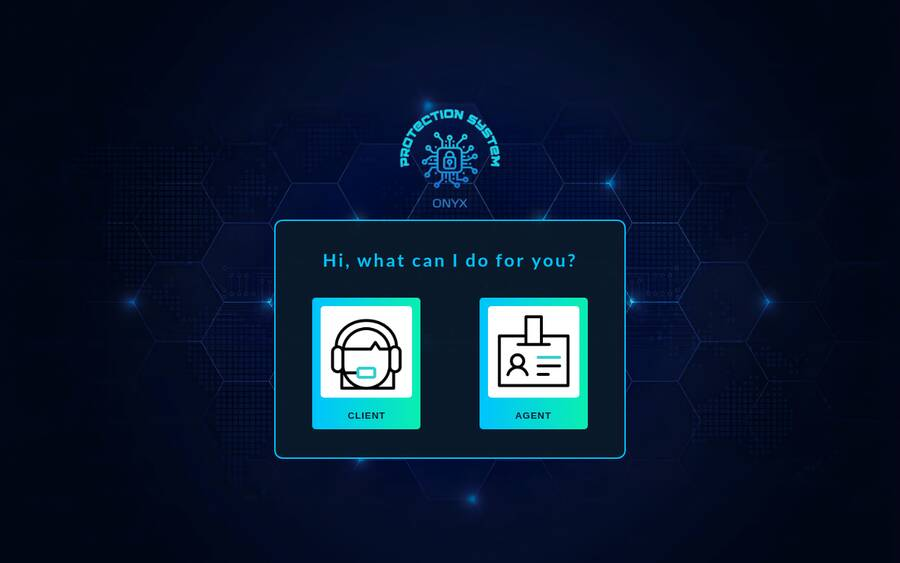
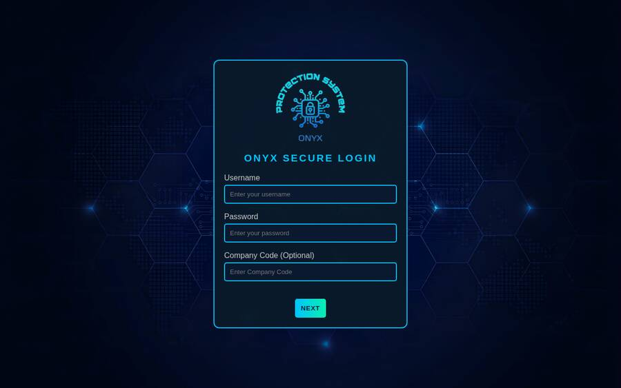
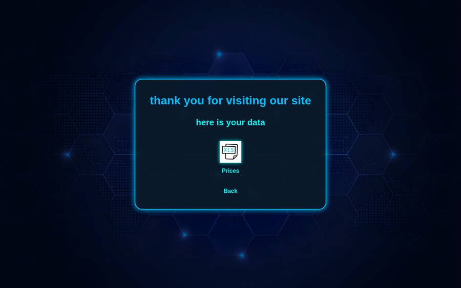

# Onyx Protection System

A Flask web app that guards a small company intranet with **device-bound authentication**, **encryption at rest** and **intrusion logging**, plus a real-time team chat with file sharing.

> University group project (second year). I contributed to the design and implementation of the application and its security features, together with my teammates.

## Screenshots

| Landing page | Secure login | Customer page |
|---|---|---|
|  |  |  |

## What it does

Onyx separates **customers**, **guests** and **members (agents)**. Customers see only public data (a price list). Staff sign in with a username, a password **and** a registered device (MAC address). Anyone who fails is treated as an intruder.

## Features

- **Two-factor-style login:** username + password + the MAC address of the client machine must all match a registered user.
- **Role-based access:** `member` and `guest` roles get different dashboards and different data. An optional company code unlocks the member-only user management page.
- **Encryption at rest:** sensitive files (`.json`, `.xlsx`, `.pdf`, `.txt`, `.doc(x)`) are encrypted with AES-256-GCM, with a key derived through PBKDF2-HMAC-SHA256 (100k iterations). They are decrypted only after a login attempt starts and are locked again on failure or logout.
- **Intrusion detection and logging:** failed logins are logged with IP, MAC, name and time. Members who fail are logged separately from unknown users. Failed attempts re-lock the data.
- **Decoy ("honeypot") page:** intruders get a fake data page instead of an error.
- **Rate limiting:** a simple per-IP request limiter returns HTTP 429 when abused.
- **Member management:** members can add users, pick a role, and bind devices found on the local network (ARP scan).
- **Real-time chat:** Flask-SocketIO chat with file uploads, message deletion (own messages only) and a notification sound.
- **Custom UI:** dark, themed pages with CSS animations and GIF icons.

## Tech stack

Python, Flask, Flask-SocketIO, `cryptography` (AES-GCM, PBKDF2), Jinja2 templates, HTML/CSS/JavaScript, JSON file storage.

## Project structure

```
web.py            Flask app: routes, auth, encryption, logging, chat
templates/        Jinja2 pages (landing, login, dashboards, chat, add user)
static/           CSS, JS, images, GIFs, audio, sample documents
conf/             Place your key file here (git-ignored)
uploads/          Chat uploads (git-ignored)
docs/screenshots/ README images
```

## Run it

The app targets **Windows** (it calls `arp`, `ping -n` and `ipconfig` to read MAC addresses).

```bash
pip install -r requirements.txt

# 1. Choose an encryption passphrase
set ONYX_KEY=choose-a-long-passphrase        # PowerShell: $env:ONYX_KEY="..."

# 2. Create your user list from the example
copy static\users.example.json static\users.json
#    Edit it: use your own MAC address (run `getmac`), username and password.

# 3. Start
python web.py
```

Open http://127.0.0.1:5001. Use the **Agent** button to sign in.

## Known limitations

This was a learning project. Passwords are stored in plain JSON, the PBKDF2 salt is a constant, and MAC addresses can be spoofed. A production version would hash passwords, use a random salt per file, add TLS and use a real database. Sample spreadsheets in `static/` contain made-up data.

## Credits

Built as a second-year university group project. No license is attached, because the code was written by a team.
